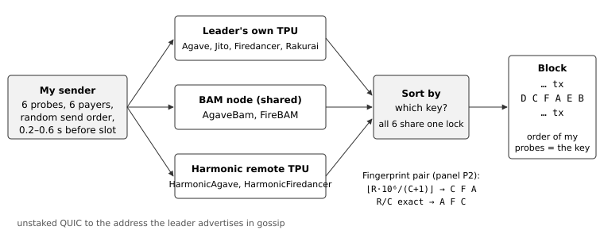

# Solana: which sort key each validator uses, and how strictly in time

I sent my own small transactions straight to the leaders of 16 Solana mainnet validators (8 client types)
after the Alpenglow switch and read where they landed in each block. For each validator I ask which *key*
(sorting rule) orders its block, and how strictly that holds in time. In short: Agave and Firedancer use two
different exact rules, FireBAM follows Agave's, one Jito validator sorts by total fee, and Harmonic fits a
formula outside the usual list.

## Findings

Measured 2026-10-29 to 11-01 (UTC), across all hours, plus an exploratory Harmonic test on 11-02.
A *panel* is six probes sent together. A *full window* means all six landed in one block of the target's
4-slot leader window. The exact-order column counts matches / full windows. The *overtaking horizon* is
the largest send gap at which a later, richer probe lands first in at least half of pairs.

| Client | Key that orders queued transactions | Full windows, exact order | Overtaking horizon |
|---|---|---|---|
| Agave | Agave's integer priority `agave_int` | 89 / 89 | 0 ms |
| Jito, `E1r4Psq8` | `agave_int` | 69 / 69 | 0 ms |
| Jito, `C8Bey3LK` | total fee (5,000 + priority fee) | 14 / 15 | not measured |
| AgaveBam | `agave_int` | 75 / 75 | 16 ms |
| FireBAM | `agave_int`, not Firedancer's rule | 80 / 80 | 24–44 ms |
| Rakurai | `agave_int` | 100 / 100 | 0 ms on two days of three |
| Firedancer | Firedancer's exact ratio `fd_exact` | 71 / 77 | 0 ms |
| Harmonic (Agave and Firedancer) | none of my eight keys; soft-capped formula fits (exploratory) | 108 / 108 days B–D; 49 / 51 on discovery day A | 12–24 ms |

1. **Two exact rules.** Agave and four forks or builders sort by ⌊R·10⁶/(C+1)⌋ (R = priority fee +
   2,500; C = scheduling cost). Firedancer uses exact R/C. *Fingerprint pairs* are probe pairs these rules
   rank oppositely, even when priorities differ by only 0.003%. Every pair went the predicted way in every
   full window.
2. **Builder and client can differ.** FireBAM runs Firedancer but sorts by Agave's key: BAM orders the
   transactions upstream. The Jito validators also differ: one follows Agave, another total fee.
3. **Harmonic: Agave's key with the compute-unit (CU) limit capped.** None of my eight keys fits. Day A's
   orders fit Agave's key with the CU limit counted only up to a cap. Memo #2 fixed that hard-cap formula on
   chain before day B, and it matched 108 / 108 full windows on days B–D on all four Harmonic validators,
   two without day-A data. Memo #3 predicted, before an 11-02 follow-up, that the limit above the cap still
   counts a little (a soft cap), and it does: a hard cap matches only 8 of the follow-up's 27 full windows,
   plain Agave 19. Fitted to all the data, the cap is 1,500–1,963 CU with 10–25% of the limit above it
   counted; that range is a fit, not a prediction. Exploratory throughout.
4. **Waiting versus arriving.** Queued probes sort everywhere. During the window, a richer probe sent
   4 ms later does not pass on Agave, Jito or Firedancer; through BAM and Harmonic it can pass one sent
   12–44 ms earlier.
5. **Held out.** Outside Harmonic, days B–D yielded 13 passed key predictions, 1 failed (total-fee Jito)
   and 7 "insufficient data": fewer than the registered minimum of 15 usable panels that day. All 76 full
   windows from those seven matched, a descriptive count rather than a pass.

Labels: *registered* = a test fixed before the campaign; *exploratory* = a pattern found in data and
checked later, not confirmed; *descriptive* = a count without a test (including the exact-order column).

Every row is traced to slots and signatures in [CLAIMS.md](CLAIMS.md); [REPORT.md](REPORT.md) has the full
results, dates, deviations and what went wrong.



## How it works

- **Probe.** One legacy transaction shape: fee payer, never-funded "lock" account, three compute-budget
  instructions (CU limit L, CU price p, loaded-data limit D), and a 0-lamport transfer to the lock. Only
  L, p and D change, moving fee and scheduling cost in different directions.
- **Panels.** Six payers share a lock, forcing serial execution so block order reveals scheduler order.
  I send just before the leader window. Two fixed panels make every candidate-key pair disagree on at
  least two probe pairs. Controls use six identical probes for tie-breaking, or separate locks for no
  contention.
- **Trains.** 10–12 probes with equal limits, sent 4 ms or 12 ms apart during the window, with fees rising
  or, as a control, falling. First-in, first-out (FIFO) keeps send order; sorting allows overtaking.
- **Route.** Unstaked QUIC straight to the TPU address each leader advertises, every send time logged.
  For BAM and Harmonic that address is the block builder, so those results describe the validator *as
  reached through its advertised ingress*. BAM endpoints closed my connection in 21% of windows (own-IP
  6%, Harmonic 0%); 84 of the 628 probes on a closed connection still landed.
- **Schedule.** Calibration 10-27 to 10-28. Days A–C (10-29 to 10-31), six 4-hour blocks each over all
  UTC hours: day A picks builders' keys and horizons, B and C test them; Agave, Jito and Firedancer face
  their source-code key throughout. Tier 1 = eight main validators; Tier 2 = a second per client on day C.
  Day D (11-01) topped up four shortfalls; 11-02 was the Harmonic follow-up.
- **Pre-registration.** [PREREG.md](PREREG.md) and [design/design.json](design/design.json) fix questions,
  keys, decision rules and quotas before campaign probes. On-chain hashes:
  memo #1 [`TywPFLUz…`](https://explorer.solana.com/tx/TywPFLUznyNThfq9hiKp34eikwW8ZHxs3xefwWfABCBsceRaSLJvnAPPk977XyTXSTJWGsMnW6i43cr2NGTwXxd)
  (commit `0bb3ee5`), memo #2 [`mbp3zEGq…`](https://explorer.solana.com/tx/mbp3zEGqTFnkJuLZkRndhWu4yFRkdxvwHJNMKZimE4QzbAeBMrT2RhE2N7ve8Z6F9BWkTV4ECBG1LoqwaCWJaNF)
  (commit `f3f1c52`, the day-A picks, before day B), memo #3 [`4zMGqri3…`](https://explorer.solana.com/tx/4zMGqri3f4ufA5sAFoZsr5VXQM6V4q1YxVpiqHQLgCFwjAtbVLkSTS1yWBK3vRCdXQmgMPP4TynR67CGf41E7HUf)
  (commit `f705581`, the Harmonic follow-up, before its first probe).

## Why this design

- **Known inputs.** My probes give known limits, fees, send times, order and target; the shared lock
  makes block order interpretable.
- **Designed disagreements.** Ordinary fee ladders let candidate keys agree. These panels separate
  concrete rules, including base-fee treatment and the 0.003% Agave/Firedancer difference.
- **Window-level tests.** Within-block pairs are dependent. A key must beat every rival in a majority of
  windows (exact binomial tests, Holm across eight main validators). I report strictness separately;
  "no rule detected" is valid.
- **Held-out checks.** Day-A picks are fixed on chain before day B and tested on days B–D.
- **Horizon.** Batching and stalled queues can look alike; the measurement avoids claiming a mechanism.
- **Direct QUIC.** RPC `sendTransaction` obscures send time and target, retries and forwards to multiple
  leaders.

## What this design does NOT separate

1. When a probe *arrived* at the leader or builder. I log send times; network jitter below ~1 ms is noise.
2. The validator's own scheduler from an upstream builder using the same comparator.
3. Keys outside the eight candidates that rank both panels identically (any monotone transform of
   reward/cost, for example).
4. Private operator settings (Firedancer pacing, Harmonic strategy, BAM plugins): I see behaviour, not
   configuration.
5. Staked or stake-weighted paths. I am an unstaked sender.
6. High fees and full blocks. My fees are tiny; block load is recorded, not controlled.
7. Execution order of non-conflicting transactions. Block order is not execution start.
8. A whole client family from one or two validators, or validators behind one shared builder endpoint
   from each other.
9. Bundles and tips (out of scope). Block-wide context may contain bundles.
10. Order among probes that did not land. Inclusion is reported separately.

## Reproduce

```sh
docker compose up                                        # offline: recompute every number from data/raw, diff with data/derived
docker compose run --rm verify                           # online: re-fetch a sample of claimed blocks (VERIFY_ALL=1 for all)
docker compose run --rm test                             # unit tests
docker compose run --rm dryrun                           # plan the next 15 min of real leader windows, send nothing
```

`docker compose up` fails if recomputed numbers differ. `verify` checks signatures at recorded indices,
payers, fees, decoded limits, the leader (block fee-reward recipient), and `getSlotLeaders` for all four
window slots. Send times, intended targets and client labels depend on logs and snapshots.

Live sending requires `--live`, `ITB_LIVE=1`, `--max-spend-sol` and a read-only key-directory volume.
Funding, memo and sweep commands also require `ITB_LIVE=1`. Each send reserves its worst-case fee;
code caps total spend at 0.05 SOL and reconciles on-chain balances after every block.

## Listing requirements → where

| Requirement | Where |
|---|---|
| ≥6 validators, ≥3 clients, own mainnet transactions after Alpenglow | [design/candidates.json](design/candidates.json), `data/raw/*/probes.jsonl.gz` (all slots ≥ 459,653,000, checked in code) |
| Ordering rule, how strictly, or no rule, per validator | Findings above, [REPORT.md](REPORT.md) §3, [data/derived/tables.md](data/derived/tables.md) |
| All raw data: signatures, slots, blocks | `data/raw/<run>/` (probes, outcomes, blocks, windows, snapshots, SHA256SUMS) |
| One-command reproduction | `docker compose up`; CI runs it on amd64 and arm64 |
| Dry run by default, live behind a flag, spend cap in code | `itb run` (dry unless `--live` + `ITB_LIVE=1`), [itb/ledger.py](itb/ledger.py) |
| Keys via env or volume, never in the repo | `ITB_KEYS_DIR` volume, read-only; pre-commit check in [.githooks/](.githooks/) |
| Why this design / what it does NOT separate | the two sections above |
| Date of every measurement, what went wrong | [REPORT.md](REPORT.md) §4–§6, `run.json` in every run folder |

## Cost

0.048173 SOL in fees out of the 0.05 SOL cap, everything included: 0.047973 SOL of probe block fees
(calibration 0.0039, day A 0.0132, B 0.0097, C 0.0140, D 0.0047, Harmonic follow-up 0.0025) and 0.0002 SOL
for 40 operations transactions. `docker compose up` re-adds them from the raw data and the final audit and
checks the sum against the on-chain total and the wallet balances ([REPORT.md](REPORT.md) §6). 0.011237 SOL
went back to the funding wallet; 0.00065 SOL is stuck in the main wallet (§4).

## Repo map

`itb/`: sender, collector and analysis (`itb --help`). `design/`: panels, candidate keys, prediction
table, quotas, pre-registration hashes. `data/raw/`: every probe ever signed and every block it landed in.
`data/derived/`: results and tables recomputed by `docker compose up`. `figures/`: redrawn from the data.
